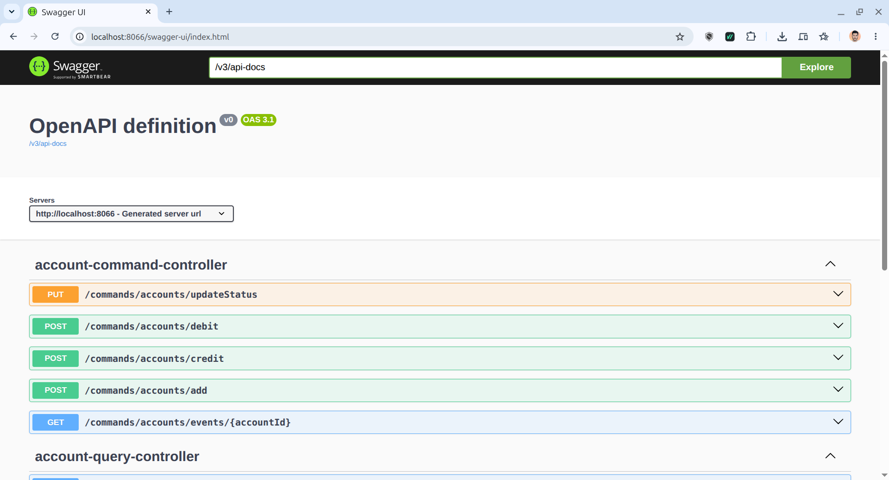
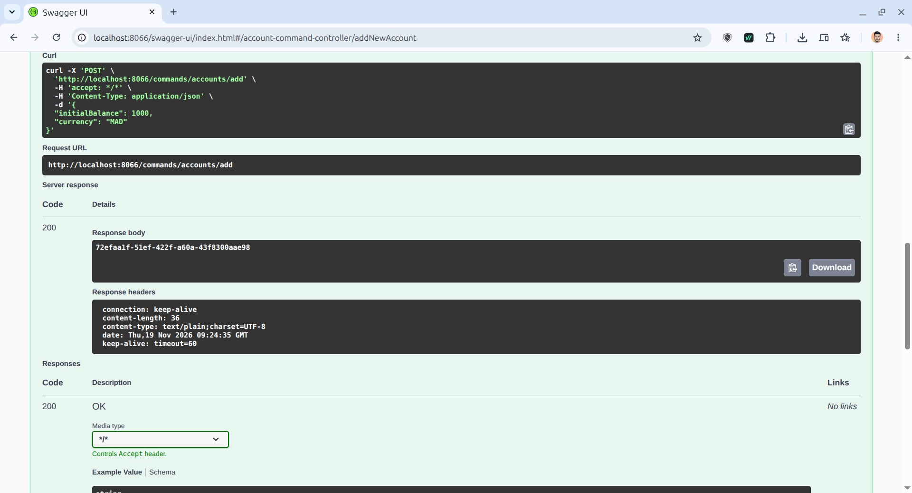
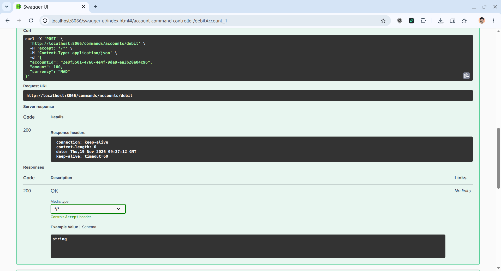
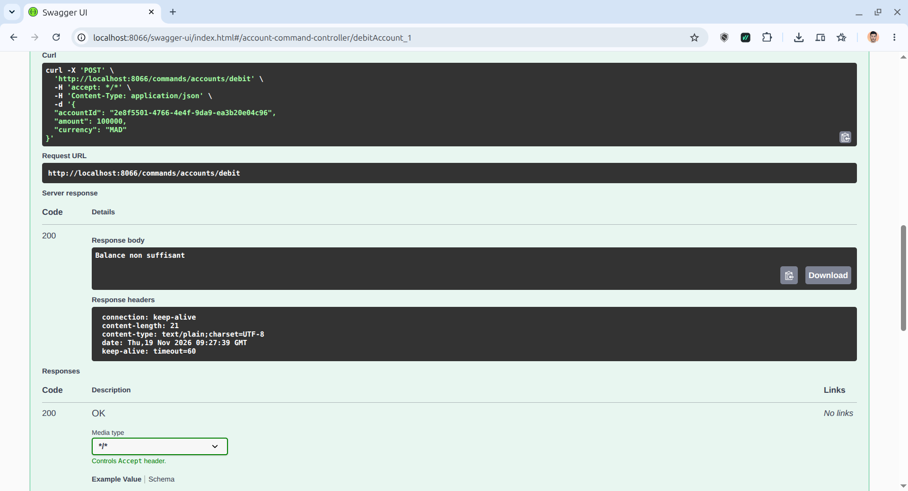
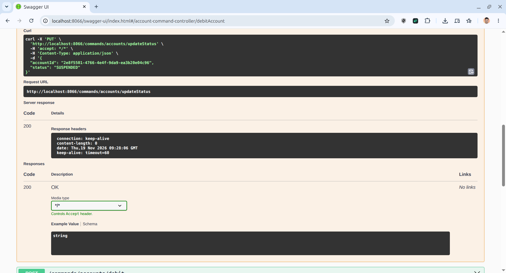
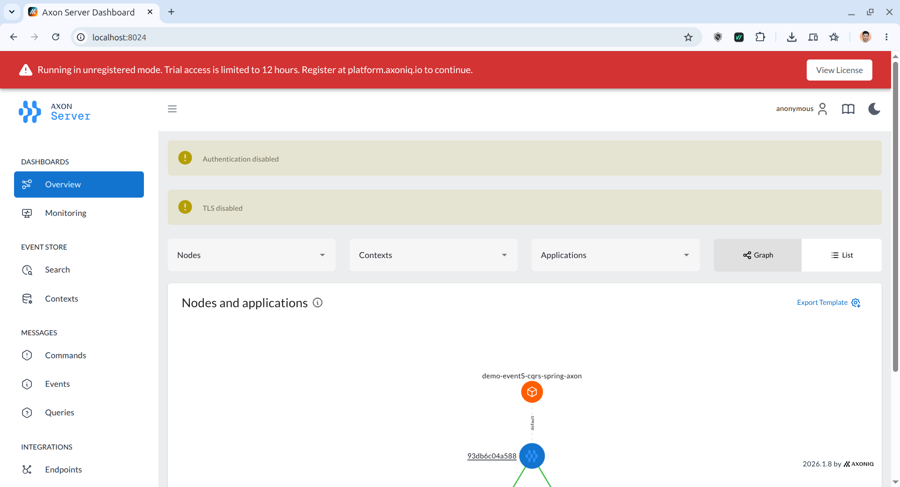

<div align="center">
  

  

  <p>
    
    
    
    
    
    
    
  </p>

  <p>
    <a href="docs/ARCHITECTURE.md">Architecture</a> ·
    <a href="docs/API.md">API REST &amp; SSE</a> ·
    <a href="docs/SCREENSHOTS.md">Galerie des Captures</a> ·
    <a href="docs/VERIFICATION.md">Rapport de Vérification</a>
  </p>
</div>

---

## À propos du projet

**AxonBank** est une application bancaire distribuée implémentant les patterns architecturaux **CQRS** (Command Query Responsibility Segregation) et **Event Sourcing** avec **Java 21**, **Spring Boot 3** et **Axon Framework 4**.

Le système découple rigoureusement le modèle d'écriture (Command Side), en charge d'exécuter les règles métier et d'émettre des événements immuables dans l'**Event Store** d'Axon Server, du modèle de lecture (Query Side), alimenté par des projections asynchrones persistées dans **PostgreSQL**. Un flux réactif Server-Sent Events (SSE) diffuse en temps réel chaque opération financière aux clients connectés.

> [!NOTE]
> Pour une analyse approfondie des choix de conception, des schémas d'interaction et de la sérialisation des événements, consultez la [Documentation d'Architecture](docs/ARCHITECTURE.md).

### Aperçu en action

<div align="center">
  
  <p><em>Figure 1 : Interface Swagger UI interactive exposant l'ensemble des endpoints de commande et de requête</em></p>
</div>

<details>
  <summary><b>Voir plus de captures d'écran (Opérations, Contrôles Métier &amp; Infrastructure)</b></summary>
  <br/>

  <table width="100%">
    <tr>
      <td width="50%" align="center">
        <b>Création et Activation d'un Compte</b><br/><br/>
        
      </td>
      <td width="50%" align="center">
        <b>Opération de Crédit Bancaire</b><br/><br/>
        
      </td>
    </tr>
    <tr>
      <td width="50%" align="center">
        <b>Opération de Débit avec Contrôle de Solde</b><br/><br/>
        
      </td>
      <td width="50%" align="center">
        <b>Rejet Métier : Solde Insuffisant</b><br/><br/>
        
      </td>
    </tr>
    <tr>
      <td width="50%" align="center">
        <b>Gestion du Cycle de Vie et Statuts</b><br/><br/>
        
      </td>
      <td width="50%" align="center">
        <b>Console d'Administration Axon Server</b><br/><br/>
        
      </td>
    </tr>
  </table>

  <p align="center">
    <em>Retrouvez l'inventaire exhaustif des 12 captures annotées dans la <a href="docs/SCREENSHOTS.md">Galerie des Captures</a>.</em>
  </p>
</details>

---

## Pourquoi utiliser ce projet ?

AxonBank sert de référence pratique pour concevoir des systèmes transactionnels financiers haute disponibilité :

- **Traçabilité Intégrale (Event Sourcing) :** Aucune perte d'information par mise à jour destructive. L'historique complet des événements (`AccountCreatedEvent`, `AccountCreditedEvent`, etc.) constitue la source unique de vérité et permet la reconstruction exacte de l'état d'un compte à tout instant.
- **Séparation des Préoccupations (CQRS) :** Modèles d'écriture et de lecture optimisés indépendamment. Le modèle d'écriture valide les contraintes métier en mémoire via l'agrégat, tandis que le modèle de lecture sert des requêtes relationnelles rapides sans verrouiller le cœur transactionnel.
- **Communication Réactive en Temps Réel :** Diffusion instantanée des transactions par Server-Sent Events (SSE) grâce à Project Reactor et au `QueryUpdateEmitter` d'Axon.
- **Infrastructure Prête à l'Emploi :** Déploiement conteneurisé avec Docker Compose intégrant PostgreSQL 17, Axon Server (nœud gRPC et console web) et PgAdmin 4.

### Stack Technique

| Couche / Domaine | Technologies | Rôle et Configuration |
| :--- | :--- | :--- |
| **Langage & Framework** | Java 21, Spring Boot 3.4.3 | Cœur applicatif, injection de dépendances et configuration |
| **Framework CQRS / ES** | Axon Framework 4.10.3 | Command Bus, Event Sourcing Handler, Query Bus |
| **Event Store & Routing** | Axon Server | Broker distribué, stockage immuable d'événements, communication gRPC |
| **Base de Données Lecture** | PostgreSQL 17 | Persistance relationnelle des projections JPA (`Account`, `AccountOperation`) |
| **ORM & Accès Données** | Spring Data JPA / Hibernate | Couche repository et mapping objet-relationnel |
| **Temps Réel & Réactivité** | Project Reactor 3.7.2 | Flux réactifs (`Flux<AccountOperation>`) pour le streaming SSE |
| **Documentation API** | SpringDoc OpenAPI 2.8.4 | Génération de la spécification OpenAPI v3 et interface Swagger UI |
| **Conteneurisation** | Docker & Docker Compose | Orchestration multi-conteneurs des services d'infrastructure |

---

## Pour commencer

Suivez ces instructions pour déployer l'infrastructure et exécuter l'application sur votre environnement local.

### Prérequis

- **Java Development Kit (JDK) :** Version 21 ou supérieure
- **Apache Maven :** Version 3.8+ (ou utilisation du wrapper inclus `./mvnw`)
- **Docker & Docker Compose :** Docker Engine v24+ et Docker Compose v2+

### Installation et Démarrage

1. **Cloner le dépôt :**
   ```bash
   git clone https://github.com/essoktani-yazid/axonbank-cqrs-event-sourcing.git
   cd axonbank-cqrs-event-sourcing
   ```

2. **Démarrer l'infrastructure conteneurisée :**
   ```bash
   docker compose up -d postgres axonserver
   docker compose ps
   ```

3. **Lancer l'application Spring Boot :**
   ```bash
   mvn spring-boot:run
   ```
   *(Ou via le wrapper : `./mvnw spring-boot:run`)*

### Services et Ports Exposés

| Service | Port Local | URL d'Accès | Rôle |
| :--- | :--- | :--- | :--- |
| **API AxonBank** | `8066` | `http://localhost:8066` | Serveur HTTP Spring Boot |
| **Swagger UI** | `8066` | `http://localhost:8066/swagger-ui/index.html` | Console interactive de test API |
| **Spécification OpenAPI** | `8066` | `http://localhost:8066/v3/api-docs` | Spécification JSON OpenAPI v3 |
| **Console Axon Server** | `8024` | `http://localhost:8024` | Tableau de bord de l'Event Store et métriques |
| **Axon Server gRPC** | `8124` | `localhost:8124` | Transport binaire des commandes et événements |
| **PostgreSQL 17** | `5432` | `localhost:5432` | Base de données de lecture (`es-accounts_db`) |
| **PgAdmin 4 (Optionnel)** | `8088` | `http://localhost:8088` | Interface web d'administration PostgreSQL |

---

## Exemple d'utilisation rapide

### 1. Créer un nouveau compte bancaire

```bash
curl -sS -X POST http://localhost:8066/commands/accounts/add \
  -H 'Content-Type: application/json' \
  -d '{"initialBalance": 1000, "currency": "MAD"}'
```
*La commande retourne l'identifiant UUID unique généré pour le compte.*

### 2. Créditer le compte

```bash
ACCOUNT_ID="<VOTRE_ACCOUNT_ID>"

curl -sS -X POST http://localhost:8066/commands/accounts/credit \
  -H 'Content-Type: application/json' \
  -d "{\"accountId\": \"${ACCOUNT_ID}\", \"amount\": 500, \"currency\": \"MAD\"}"
```

### 3. Débiter le compte

```bash
curl -sS -X POST http://localhost:8066/commands/accounts/debit \
  -H 'Content-Type: application/json' \
  -d "{\"accountId\": \"${ACCOUNT_ID}\", \"amount\": 200, \"currency\": \"MAD\"}"
```

### 4. Consulter la projection relationnelle

```bash
curl -sS http://localhost:8066/query/accounts/all
```

### 5. Suivre les opérations en temps réel (SSE)

```bash
curl -N -H 'Accept: text/event-stream' \
  "http://localhost:8066/query/accounts/watch/${ACCOUNT_ID}"
```

*Pour découvrir la totalité des endpoints et formats de requêtes, consultez la [Référence API Complète](docs/API.md).*

---

## Structure du projet

```text
axonbank-cqrs-event-sourcing/
├── compose.yaml                               # Orchestration Docker Compose (PostgreSQL, Axon Server, PgAdmin)
├── pom.xml                                    # Dépendances Maven (Spring Boot, Axon, PostgreSQL, Reactor)
├── README.md                                  # Documentation principale
├── LICENSE                                    # Licence MIT
├── docs/
│   ├── ARCHITECTURE.md                        # Documentation d'architecture détaillée et diagrammes Mermaid
│   ├── API.md                                 # Spécification exhaustive des endpoints REST et SSE
│   ├── SCREENSHOTS.md                         # Galerie complète des 12 captures d'écran annotées
│   ├── VERIFICATION.md                        # Rapport de validation et tests d'exécution
│   └── screenshots/                           # Fichiers graphiques, métadonnées JSON et scripts de scénarios
└── src/
    ├── main/
    │   ├── java/ma/formation/demoeventscqrsspringaxon/
    │   │   ├── DemoEventSCqrsSpringAxonApplication.java
    │   │   ├── commands/                      # Modèle d'Écriture (Command Side)
    │   │   │   ├── aggregates/                # AccountAggregate (décisions métier et évolution)
    │   │   │   ├── commands/                  # Objets de commande (Add, Credit, Debit, UpdateStatus)
    │   │   │   ├── controllers/               # AccountCommandController
    │   │   │   └── dto/                       # Request DTOs
    │   │   ├── enums/                         # AccountStatus, OperationType
    │   │   ├── events/                        # Événements immuables du domaine
    │   │   └── query/                         # Modèle de Lecture (Query Side)
    │   │       ├── controllers/               # AccountQueryController (REST & SSE)
    │   │       ├── dtos/                      # AccountStatementReponseDTO
    │   │       ├── entities/                  # Entités JPA (Account, AccountOperation)
    │   │       ├── handlers/                  # Projections (AccountEventHandler, AccountQueryHandler)
    │   │       ├── queries/                   # Objets de requête (GetAllAccounts, GetStatement, Watch)
    │   │       └── repository/                # Spring Data JPA Repositories
    │   └── resources/
    │       └── application.properties         # Configuration Spring Boot, datasource et sérialiseurs Axon
    └── test/
        └── java/ma/formation/demoeventscqrsspringaxon/
            └── DemoEventSCqrsSpringAxonApplicationTests.java
```

---

## Tests et Assurance Qualité

Pour compiler le projet et exécuter les tests automatisés :

```bash
# Exécuter les tests unitaires et d'intégration
mvn test

# Compiler et packager l'application en archivant le JAR
mvn package
```

> [!NOTE]
> Les tests d'intégration du contexte Spring nécessitent que les services PostgreSQL et Axon Server soient démarrés via Docker Compose.

---

## Aide et Support

Pour toute interrogation sur l'architecture, la configuration ou les modèles du projet :
- **Documentation Technique :** Explorez les guides détaillés dans le dossier [`docs/`](docs/).
- **Traçabilité des Tests :** Consultez le [Rapport de Vérification](docs/VERIFICATION.md).
- **Contact :** Échangez directement avec l'auteur via LinkedIn ou son portfolio.

---

## Contribuer

Les propositions d'amélioration et contributions sont les bienvenues :
1. **Forkez** le projet
2. Créez une branche de fonctionnalité (`git checkout -b feature/amelioration-projection`)
3. Validez vos changements avec Conventional Commits (`git commit -m 'feat(projection): optimize transaction history query'`)
4. Pushez vers votre branche (`git push origin feature/amelioration-projection`)
5. Ouvrez une **Pull Request**

---

## Auteur

<div align="center">

**Yazid ESSOKTANI**  
*Full-Stack Web & AI Developer*

[](https://www.essoktani.tech/)
[](https://www.linkedin.com/in/yazid-essoktani-337549251)
[](https://github.com/essoktani-yazid)

</div>

---

## Licence

Distribué sous la licence **MIT**. Consultez le fichier [`LICENSE`](LICENSE) pour plus d'informations.
