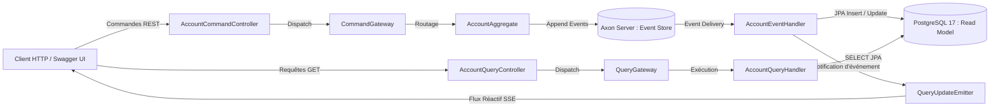
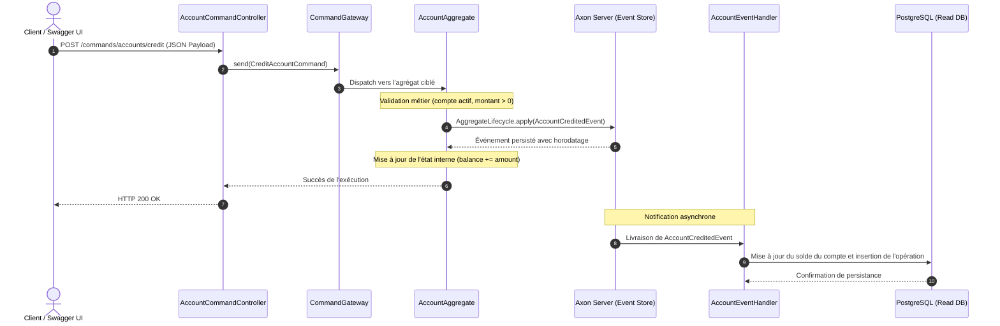
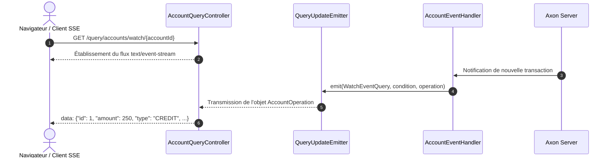

# Architecture du Système — AxonBank

> Ce document décrit l'architecture technique, les choix de conception, les flux d'événements et le modèle de persistance d'**AxonBank**.

---

## 1. Vue d'ensemble (High-Level Design)

AxonBank repose sur une architecture distribuée pilotée par les événements (**Event-Driven Architecture**), implémentant les patrons **CQRS** (Command Query Responsibility Segregation) et **Event Sourcing** via **Axon Framework** et **Axon Server**.

Le système applique une séparation stricte entre les responsabilités d'écriture (Command Side) et de lecture (Query Side) :

---

## 2. Composants Principaux

| Composant | Technologie | Périmètre & Responsabilités |
| :--- | :--- | :--- |
| **Command Controller** | Spring Web (`@RestController`) | Expose les points d'entrée HTTP pour l'ajout, le crédit, le débit et le changement de statut de compte. Transforme les DTOs en commandes Axon. |
| **Command Gateway** | Axon Framework | Route de façon asynchrone les commandes vers l'instance appropriée de l'agrégat en gérant la sérialisation et le contexte transactionnel. |
| **Account Aggregate** | Axon Aggregate (`@Aggregate`) | Cœur transactionnel du domaine. Valide les règles métier (solde positif, compte actif, disponibilité des fonds) et émet les événements correspondants. |
| **Axon Server** | Axon Server (gRPC) | Broker d'événements et Event Store centralisé haute performance. Assure le stockage immuable et ordonné de tous les événements du domaine. |
| **Event Handler** | Axon Event Handler (`@EventHandler`) | Écoute les événements publiés par l'Event Store et projette l'état dans la base de lecture relationnelle. |
| **PostgreSQL Read DB** | PostgreSQL 17 / Spring Data JPA | Stocke les vues dénormalisées optimisées pour la consultation (`Account` et `AccountOperation`). |
| **Query Controller & Handler** | Spring Web & Axon (`@QueryHandler`) | Répond aux requêtes de consultation (`GetAllAccountsQuery`, `GetAccountStatementQuery`). |
| **Streaming Gateway** | Project Reactor / `QueryUpdateEmitter` | Diffuse en temps réel les opérations financières via Server-Sent Events (`text/event-stream`). |

---

## 3. Flux de données (Data Workflow)

### Cycle de vie d'une Commande (Command Execution Flow)

Le diagramme suivant détaille le traitement d'une opération financière (crédit ou débit) de sa réception à sa projection relationnelle :

### Diffusion Réactive en Temps Réel (Server-Sent Events)

---

## 4. Modèle de Données & Persistance

### 4.1. Modèle d'Événements (Event Model)

Les événements constituent la source de vérité absolue du système. Ils sont immuables et sérialisés au format JSON dans l'Event Store :

| Événement | Attributs Clés | Déclencheur Métier |
| :--- | :--- | :--- |
| `AccountCreatedEvent` | `id`, `initialBalance`, `currency` | Création d'un compte avec un solde strictement positif. |
| `AccountActivatedEvent` | `id`, `status` | Activation consécutive à la création du compte. |
| `AccountCreditedEvent` | `id`, `amount`, `currency` | Dépôt de fonds sur un compte actif. |
| `AccountDebitedEvent` | `id`, `amount`, `currency` | Retrait de fonds sous réserve de provision suffisante. |
| `AccountStatusUpdatedEvent` | `id`, `status` | Transition explicite du statut vers `SUSPENDED` ou `BLOCKED`. |

### 4.2. Schéma Relationnel de Lecture (Read Model)

La base relationnelle PostgreSQL matérialise les projections pour répondre sans latence aux requêtes de consultation :

- **Table `accounts` :**
  - `id` (VARCHAR, Clé primaire) : Identifiant UUID du compte bancaire.
  - `balance` (DOUBLE PRECISION) : Solde projeté consolidé.
  - `created_at` (TIMESTAMP WITH TIME ZONE) : Date de création issue de l'événement initial.
  - `status` (VARCHAR) : Statut opérationnel (`CREATED`, `ACTIVATED`, `SUSPENDED`, `BLOCKED`).
  - `currency` (VARCHAR) : Devise du compte bancaire.

- **Table `account_operations` :**
  - `id` (BIGINT, Clé primaire auto-générée).
  - `date` (TIMESTAMP WITH TIME ZONE) : Horodatage exact de l'opération.
  - `amount` (DOUBLE PRECISION) : Montant de la transaction.
  - `type` (VARCHAR) : Type d'opération (`CREDIT`, `DEBIT`).
  - `currency` (VARCHAR) : Devise associée à la transaction.
  - `account_id` (VARCHAR, Clé étrangère vers `accounts.id`).

---

## 5. Sécurité, Infrastructure & Déploiement

- **Conteneurisation Multi-Services :** L'infrastructure est définie dans [compose.yaml](../compose.yaml) :
  - `postgres` (image `postgres:17`) : Port `5432`, persistance sur volume Docker nommé `axonbank-cqrs-event-sourcing_postgres-data`.
  - `axonserver` (image `axoniq/axonserver:latest`) : Console web sur port `8024`, transport binaire gRPC sur port `8124`.
  - `pgadmin4` (image `dpage/pgadmin4:latest`, optionnel) : Port `8088`.
- **Stratégie de Sérialisation :**
  - Événements et messages généraux : `Jackson` (JSON).
  - Messages et bus de requête : `XStream` 1.4.20.

---

## 6. Spécificités Techniques & Limites Observées

- **Types monétaires :** L'implémentation pédagogique emploie des valeurs primitives `double`. En environnement bancaire de production, `BigDecimal` ou le pattern `Money` avec devise normalisée est requis.
- **Sérialisation des Java Records :** XStream 1.4.20 présente une incompatibilité native de désérialisation sur les types `java.lang.Record` (`AccountStatementReponseDTO`), provoquant une levée d'exception interne lors de l'appel à la route du relevé.
- **Persistance Axon Server :** Le service `axonserver` dans le fichier Compose actuel utilise un stockage non monté en volume persistant hôte ; une réinitialisation du conteneur réinitialise l'Event Store.

---

[Retour au README principal](../README.md)
