# Captures d’écran et tests API

Galerie des **12 captures réelles** de l’application, de ses tests API et de son infrastructure, vérifiées le 19 novembre 2026. Les dix captures web mesurent **1920 × 1040 pixels** et conservent la vraie barre d’adresse Chrome. Les deux captures des conteneurs montrent des fenêtres natives GNOME Terminal ; leurs dimensions figurent dans l’inventaire.

Les captures présentent les interfaces locales et les réponses réellement obtenues, y compris le rejet pour solde insuffisant et l’erreur HTTP 500 du relevé. Les sections de tests détaillent les requêtes, les résultats et leur portée.

## Interfaces de l’application

### 1. Documentation interactive Swagger

Catalogue des opérations REST dans Swagger UI.

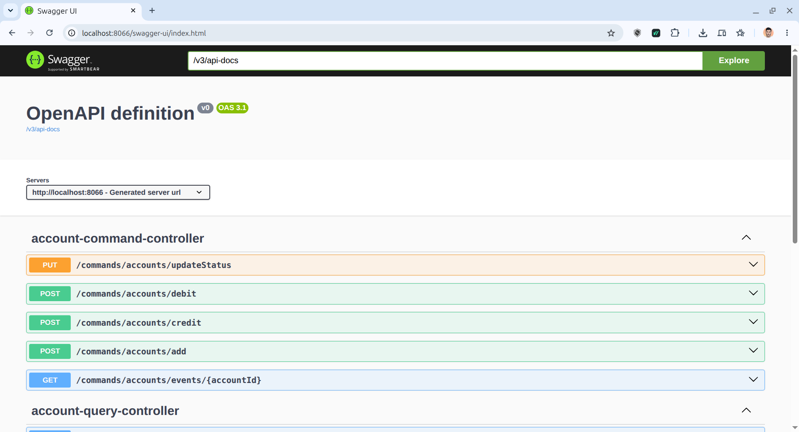

### 2. Projection des comptes

Comptes bancaires lus depuis la projection PostgreSQL.

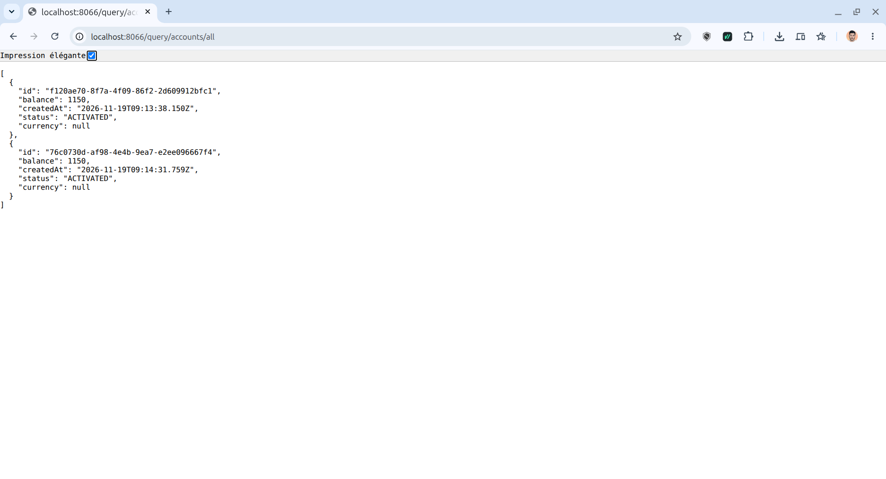

### 3. Console Axon Server

Console locale du serveur Axon.

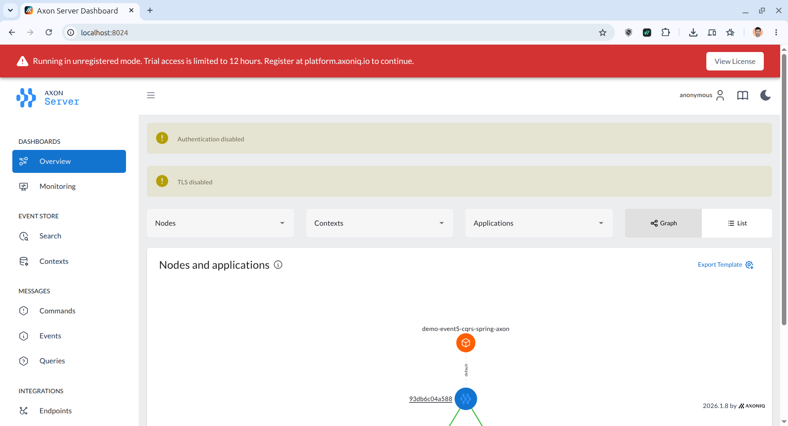

## Tests API en images

Les sept captures suivantes montrent des tests de parcours API réellement exécutés dans Swagger UI sur `http://localhost:8066`. Chaque image présente la requête et la réponse du serveur ; le code HTTP et le corps ont été contrôlés avant l’enregistrement.

La première capture illustre une création indépendante. Les six suivantes utilisent un second compte de démonstration dédié, créé auparavant à `1000 MAD` ; son identifiant reste identique dans ces six requêtes.

Il s’agit de tests de parcours API, distincts du test Spring `contextLoads`. Le [bilan des vérifications](VERIFICATION.md) précise ce qui a été exécuté et les limites constatées. Ces captures documentent l'exécution réelle des parcours d'API.

### 4. Création d’un compte

Requête `POST /commands/accounts/add` avec un solde initial de `1000` et la devise `MAD`. Le serveur retourne HTTP **200** et un identifiant UUID, visible dans le corps de réponse.

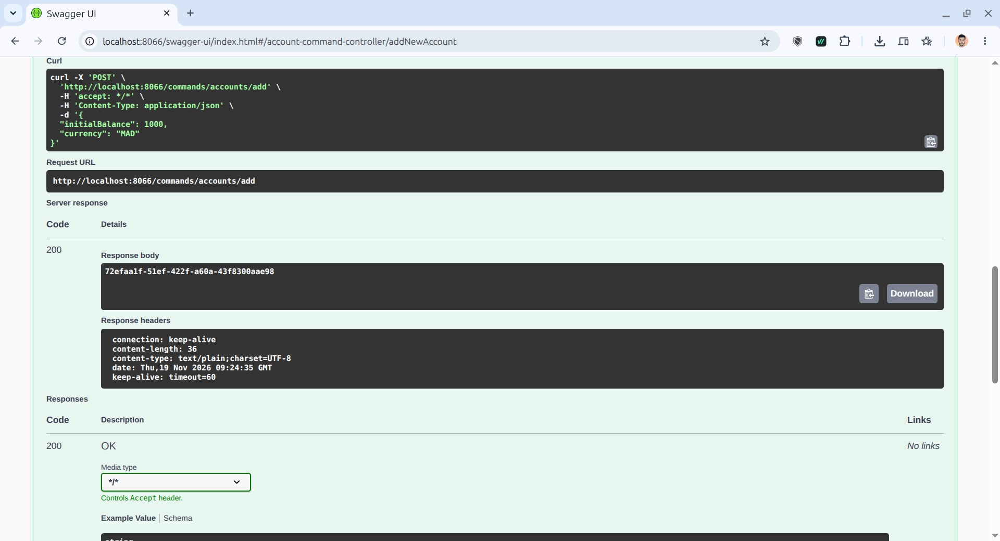

### 5. Crédit d’un compte

Sur un compte local dédié, initialisé à `1000 MAD`, la requête `POST /commands/accounts/credit` ajoute `250`. Le serveur retourne HTTP **200** avec un corps vide. Le solde attendu après projection est `1250`.


### 6. Débit d’un compte

La requête `POST /commands/accounts/debit` retire ensuite `100 MAD` du même compte activé. Le serveur retourne HTTP **200** avec un corps vide. Le solde attendu après les deux opérations est `1150` ; il est vérifié dans la projection à la fin du parcours.

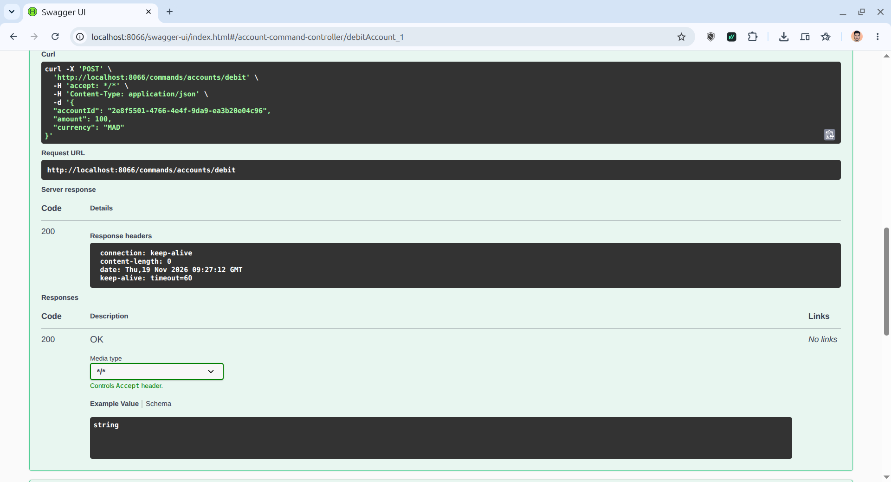

### 7. Rejet d’un débit excessif

Une tentative de débit de `100000 MAD` dépasse le solde disponible de `1150`. L’API renvoie le texte **`Balance non suffisant`**, avec HTTP **200**. Cette capture démontre la règle métier et le défaut du mapping HTTP : un code de succès ne suffit pas à conclure que la commande a été acceptée. Le solde reste inchangé.

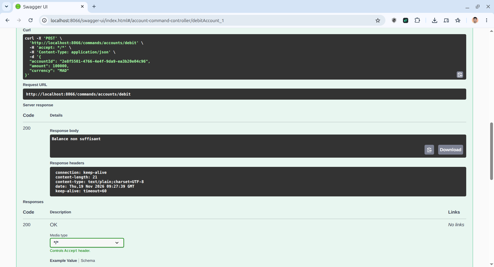

### 8. Changement de statut

La requête `PUT /commands/accounts/updateStatus` transmet le statut `SUSPENDED`. Le serveur retourne HTTP **200** avec un corps vide ; le statut suspendu est ensuite confirmé dans la projection du compte.

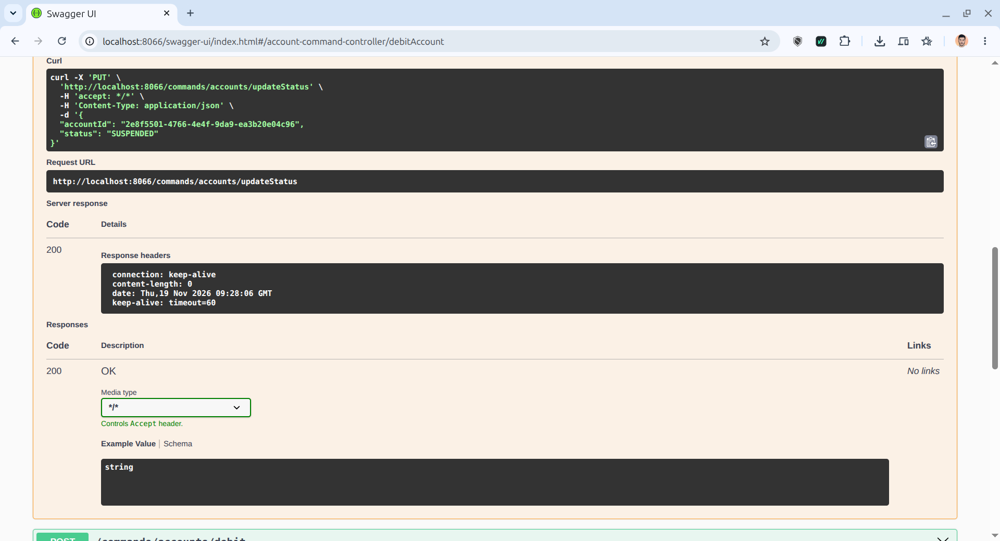

### 9. Consultation des événements

La requête `GET /commands/accounts/events/{accountId}` lit l’historique du compte. Le résultat HTTP **200** contient les événements de création, activation, crédit, débit et changement de statut. La capture montre le début de la réponse ; le scénario vérifie les cinq types d’événements dans la réponse complète.

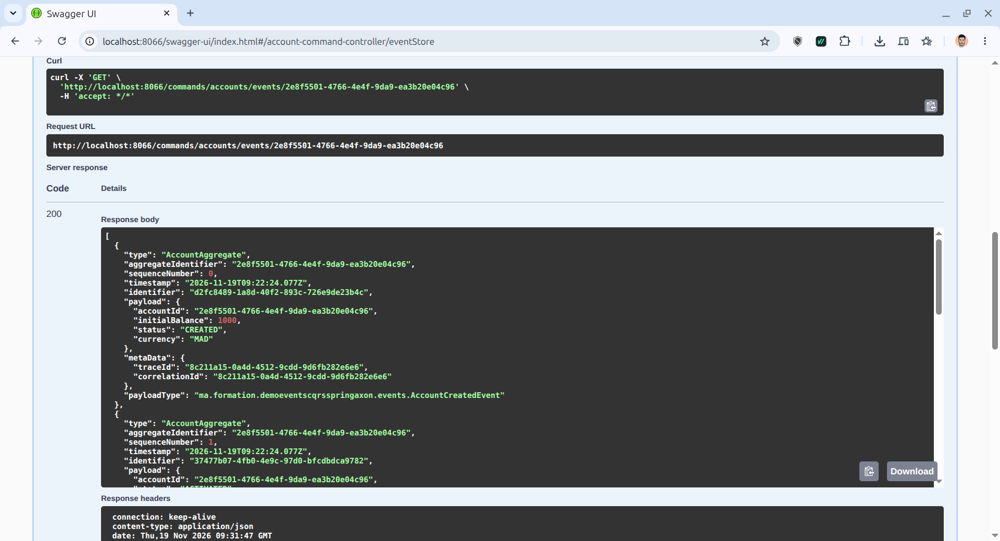

### 10. Défaut du relevé bancaire

La requête `GET /query/accounts/accountsStatement/{accountId}` renvoie HTTP **500**, avec `Internal Server Error`. Le problème déjà reproduit concerne la désérialisation du record `AccountStatementReponseDTO` par XStream 1.4.20. La capture conserve le résultat en erreur ; elle ne représente pas une validation du relevé.

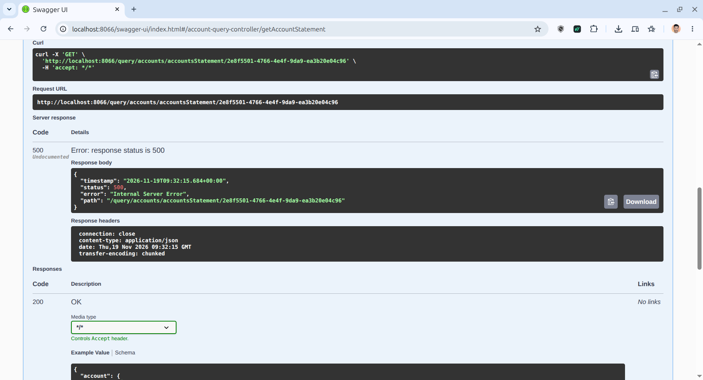

## Lancement des conteneurs

Ces deux captures montrent les services nécessaires à l’application : PostgreSQL et Axon Server. Les commandes sont exécutées à la racine du projet. Les services étaient déjà actifs lors de la capture ; la commande Compose confirme leur état et les journaux retracent leur démarrage initial.

### 11. Commande de lancement et état des services

```bash
docker compose up -d --pull never postgres axonserver
docker compose ps --format 'table {{.Service}}\t{{.Image}}\t{{.State}}\t{{.Ports}}'
```

La commande utilise les images locales déjà disponibles. Le terminal affiche les deux conteneurs `Running`, leurs images et les ports exposés : `5432` pour PostgreSQL, `8024` et `8124` pour Axon Server.

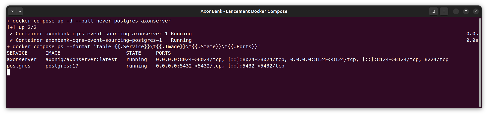

### 12. Journaux de démarrage et disponibilité

Les lignes de démarrage sont extraites des journaux Compose. PostgreSQL indique `database system is ready to accept connections` et Axon Server annonce sa version puis `Started AxonServer`. Les vérifications exécutées ensuite confirment `accepting connections` et `Axon Server HTTP 200`.

```bash
docker compose logs --no-color postgres axonserver \
  | rg 'ready to accept connections|Axon Server version|Started AxonServer'
docker compose exec -T postgres pg_isready -U admin -d es-accounts_db
curl -sS --max-time 10 -o /dev/null \
  -w 'Axon Server HTTP %{http_code}\n' http://localhost:8024/
```

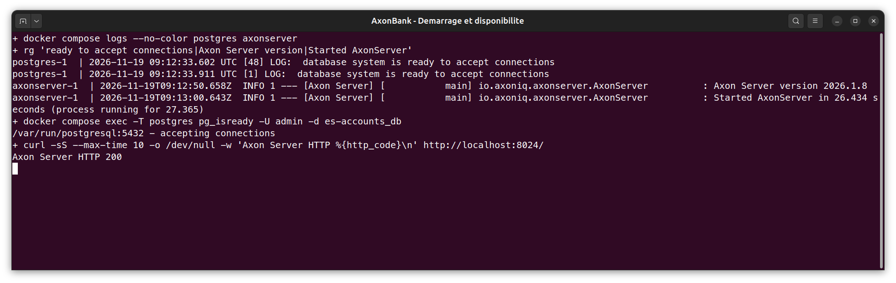

Ces images ont été prises dans des terminaux dédiés lors des phases de vérification d'infrastructure.

## Reproduction et portée

Les captures de l’interface Swagger illustrent les tests de parcours effectués en temps réel en attendant la réponse réseau et en contrôlant le code affiché. Les captures sont natives, sans recadrage ni remplacement de leur contenu.

Pour une nouvelle exécution des tests, créer un compte dédié activé à `1000 MAD`, puis exécuter les étapes dans l’ordre : crédit, débit, débit excessif, suspension, événements et relevé.

[Retour au README](../README.md) · [Référence API](API.md) · [Vérifications](VERIFICATION.md)
